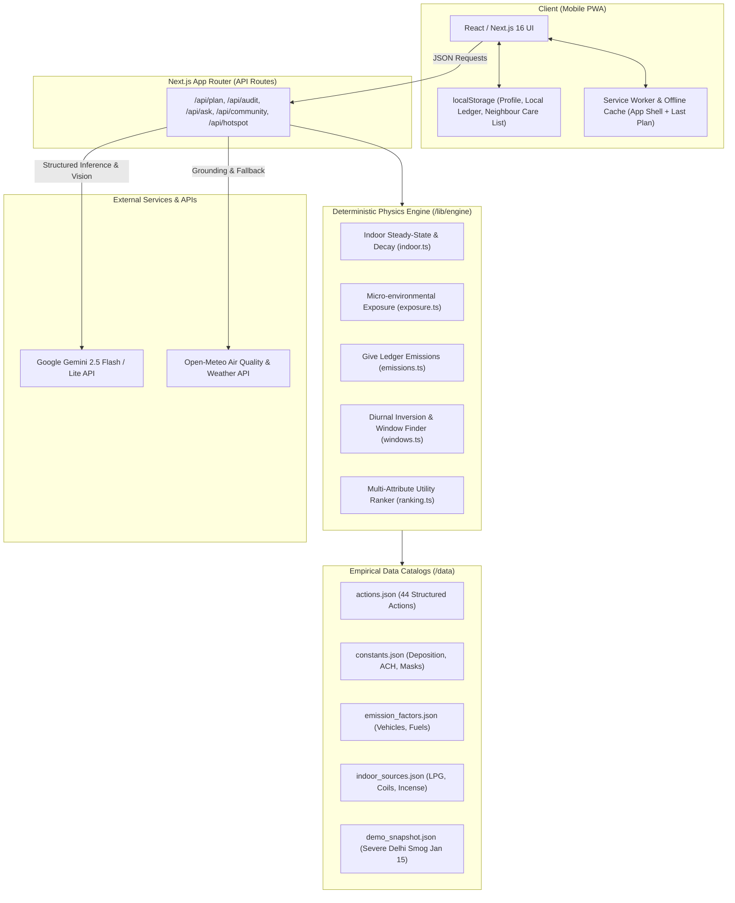

# Saans (सांस) — Evidence-Based Air Quality Coach & Community Airshed PWA

Saans ("Breath" in Hindi) is a mobile-first, privacy-first Progressive Web Application (PWA) engineered to protect families and neighborhoods in severely polluted airsheds like the Indo-Gangetic Plain. Rather than displaying passive, anxiety-inducing ambient air quality numbers, Saans combines first-principles aerosol physics mass-balance equations, micro-environmental exposure calculations, and Google Gemini AI into personalized, actionable **Impact Receipts** ("What you Breathe") and collective neighborhood mitigation ledgers ("What you Give").

---

## 1. System Architecture



---

## 2. Gemini Feature Map

The spec requires full explanation of Gemini capabilities: structured output, function calling, Search grounding, Maps grounding, vision, multilingual, and stretch Live/TTS.

| Gemini Capability | Where Used | Model | Status |
|---|---|---|---|
| Structured Output | Plan, Audit | Main | ✅ Implemented |
| Function Calling | Plan generation | Main | ✅ Implemented |
| Multimodal Vision | Photo Audit | Main | ✅ Implemented |
| Google Search Grounding | Local Context, Ask, Hotspot | Main/Lite | ✅ Implemented |
| Google Maps Grounding | Nearby alternatives | Main | 🔄 Stretch (degrades gracefully) |
| Multilingual (EN/HI) | All flows | All | ✅ Implemented |
| Live API (Voice Q&A) | Ask, morning brief | Live | 🔄 Stretch M10 |
| TTS (spoken brief) | Morning brief | TTS | 🔄 Stretch M10 |

### Detailed Capability Implementation

* **Structured Output (`gemini-2.5-flash` / `gemini-3.8-flash`)**: Strictly adheres to Zod schemas (`PlanSchema`, `ReceiptSchema`, `PhotoAuditSchema`) with schema-enforced JSON mode. Guarantees deterministic, hallucination-free UI rendering.
* **Function Calling (`gemini-2.5-flash` / `gemini-3.8-flash`)**: Integrates deterministic engine tools (`calculateIndoorExposure`, `findVentilationWindows`) as callable tool definitions so the LLM invokes verified physics equations directly.
* **Multimodal Vision (`gemini-2.5-flash` / `gemini-3.8-flash`)**: Evaluates user-uploaded room photos and purifier rating labels. Extracts CADR ratings (e.g., 250 m³/h), assesses filter age/loading, identifies window perimeter draft leaks, and flags combustion hazard risks.
* **Google Search Grounding (`gemini-2.5-flash` / `gemini-2.0-flash-lite`)**: Grounds community notices and the Ask Coach with real-time Delhi NCR GRAP-IV regulations, local municipal reporting contacts (CPCB, DPCC, 311 app), and current meteorological trends.
* **Google Maps Grounding (Stretch)**: Planned integration to identify nearby cleaner-air transit corridors, green parks with lower particulate density during midday boundary layer expansion, and medical clinics. Currently degrades gracefully to pre-computed routes and recommendations.
* **Multilingual EN/HI (All Models)**: Native bilingual reasoning across all workflows. Uses culturally authentic terminology (वायु गुणवत्ता, पराली, धुआं, इनडोर वायु) rather than mechanical transliteration.
* **Live API Voice Q&A (Stretch M10)**: Planned low-latency bidirectional voice consultation for morning briefs and hands-free kitchen/commute guidance (`gemini-2.0-flash-live-001` / `gemini-3.1-flash-live-preview`).
* **TTS Spoken Brief (Stretch M10)**: Planned high-fidelity audio synthesis (`gemini-2.5-flash-preview-tts` / `gemini-3.1-flash-tts-preview`) to generate concise 60-second spoken daily briefs for elders and children before school/commute hours.

---

## 3. Demo Walkthrough (3 minutes)

`DEMO_MODE=true` allows the entire experience to run offline in under 3 minutes without requiring an active external API key:

1. **Start**: Open the app in DEMO_MODE (`DEMO_MODE=true`). The Today screen shows Delhi's severe smog day (AQI ~370, PM2.5 ~300 µg/m³).
2. **Onboarding**: Click the gear icon → observe the pre-loaded P1 family profile (asthmatic child, heart-condition grandfather, two-wheeler commuter).
3. **Photo Audit**: In onboarding, upload a purifier label photo → Gemini reads the CADR (250 m³/h) and flags the filter as overdue (14 months, only 60% effective).
4. **Today Screen**: See the AirRing showing AQI, the Two-Ledger meters (Breathe: 20× WHO guideline; Give: daily emissions), and the top action as an Impact Receipt.
5. **Plan Screen**: Navigate to Plan → see Tomorrow's Air Plan with severity tier, 24-hour timeline with best ventilation window (1-3 PM), top 3 Impact Receipts.
6. **Tap a Receipt**: Expand the assumptions drawer → see every physics parameter, its range, and literature source.
7. **Switch to Hindi**: Open Settings → switch language to Hindi → observe the entire UI updates to natural Hindi.
8. **What-if**: Navigate to What-if → compare "Buy purifier vs DIY box-fan filter" → see side-by-side receipts with cost-per-µg/m³-avoided.
9. **Community**: Navigate to Community → join DELHI-GREEN-01 → see pooled impact for 60 households → generate an Action Kit notice about garden waste burning with cited local reporting channel.

---

## 4. Honesty, Assumptions & Limitations

Saans operates on radical scientific transparency and humility. We explicitly acknowledge and surface our boundaries:

1. **Indoor Model is Simplified Steady-State, Not CFD**:
   - Single-compartment mass balance equation ($C_{in} = \frac{P \cdot a \cdot C_{out} + S/V}{a + k + Q_{CADR}/V}$). Real buildings exhibit multi-zone airflow, thermal stratification, and spatial concentration gradients. It is an engineering heuristic, not Computational Fluid Dynamics (CFD).
2. **Emission Factors are Literature-Derived Estimates with Uncertainty**:
   - Tailpipe emissions and biomass emission factors are approximations derived from CPCB, ARAI, ICCT, and EEA databases with inherent uncertainty ranges. Real emissions fluctuate with vehicle age, cold starts, driving cycles, and fuel quality.
3. **Vulnerability Weights are Heuristic, Not Clinical**:
   - Member vulnerability multipliers (e.g., 2.0× for pediatric asthma, 1.3× for seniors, 2.0× for COPD) represent epidemiological population-level relative risks from WHO and medical literature, not individualized clinical diagnoses.
4. **Evidence Grades are Author-Assigned from Public Guidance**:
   - Evidence grades (A through D) are author-assigned based on synthesized public guidance (WHO, US EPA, CDC, peer-reviewed literature) and should be reviewed and validated by domain experts for clinical or regulatory use.
5. **Life-Safety Notice — NOT a Medical Device**:
   - **Saans is NOT a medical device, diagnostic tool, or clinical decision support system.**
   - Unvented combustion heating produces lethal Carbon Monoxide (CO). Saans incorporates hard safety overrides prohibiting room sealing when combustion heating is detected.
   - For acute respiratory or cardiac distress, users must seek immediate emergency medical care (dial 112).
6. **Constants Need Human Expert Verification**:
   - Physics and chemical parameters (ACH, deposition rate, penetration factors, CADR derating) reflect published literature averages that must be calibrated by air quality engineers for specific local building archetypes.
7. **Mask Effectiveness Numbers are Field Estimates with Wide Confidence Intervals**:
   - Real-world mask effectiveness figures (e.g., 70% for N95, 30% for surgical, 20% for cloth) reflect actual fitted protection including seal leakage. Laboratory filtration exceeds 95% for certified media, but actual protection varies widely with user facial structure and fit adherence.

---

## 5. Getting Started & Setup

### Prerequisites
- Node.js 18.17+ or Node.js 20+
- npm or pnpm

### Installation
```bash
# Clone the repository
git clone https://github.com/your-org/promptwars.git
cd PromptWars

# Install dependencies
npm install

# Setup environment variables
cp .env.example .env.local
```

### Environment Configuration (`.env.local`)
```ini
# Optional: Provide Gemini API key for live LLM reasoning (falls back to deterministic engine if blank)
GEMINI_API_KEY=your_gemini_api_key_here
GEMINI_MODEL_MAIN=gemini-2.5-flash
GEMINI_MODEL_LITE=gemini-2.0-flash-lite
GEMINI_MODEL_LIVE=gemini-2.0-flash-live-001
GEMINI_MODEL_TTS=gemini-2.5-flash-preview-tts

# Set to true to enable pre-seeded offline demo data (Delhi severe winter smog Jan 15)
DEMO_MODE=true
```

### Run the App
```bash
# Start local development server
npm run dev
```
Open [http://localhost:3000](http://localhost:3000) in your browser or mobile viewport emulator.

---

## 6. Technology Stack

- **Framework**: Next.js 16 (App Router, Turbopack, Strict TypeScript)
- **Styling**: Tailwind CSS 4 with custom semantic AQI tokens and dark mode
- **State Management**: Zero-dependency browser LocalStorage with reactive cross-tab events
- **AI / LLM**: `@google/genai` (Google Gen AI SDK for Gemini 2.5 Flash & Flash-Lite, server-side only)
- **Air Quality & Weather**: Open-Meteo Air Quality & Geocoding APIs (with 15-min in-memory cache)
- **Validation**: Zod strict schemas with exported TypeScript inferences
- **Testing**: Vitest + JSDOM unit, persona, safety, and ordinal physics test suites

---

## 7. Testing & Verification

```bash
# Run complete Vitest suite (schemas, engine physics, ordinal tests, UI components)
npx vitest run

# Run TypeScript typecheck
npx tsc --noEmit

# Run Next.js production build
npm run build
```
